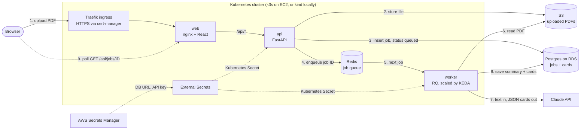

# CramCards

[](https://github.com/copaaglo/flashcards/actions/workflows/ci.yml)
[](https://github.com/copaaglo/flashcards/actions/workflows/release.yml)

Upload a lecture PDF, get a summary and a deck of flashcards written by an LLM.

The app is small on purpose. The point of this repo is everything around it: the path a change takes from a pull request to production, the way real teams run it. Tests and AI quality evals on every PR, images tagged by commit, GitOps deploys with Argo CD, a staging environment with smoke tests, a human approval before prod, infrastructure in Terraform, and metrics, logs and alerts once it's running.

## Tools used

| Concern | Tool | Where it lives |
|---|---|---|
| App | React (Vite) + nginx, FastAPI, RQ worker, Claude API | `apps/` |
| Data | Postgres (jobs, cards), S3 (uploads), Redis (job queue) | RDS + S3 in the cloud, containers locally |
| CI | GitHub Actions: ruff, eslint, pytest, helm lint, terraform validate, Trivy, AI evals, SonarCloud | `.github/workflows/ci.yml` |
| Images | Docker, multi-arch, pushed to GHCR, tagged with the commit SHA | `.github/workflows/release.yml` |
| Packaging | One Helm chart, one values file per environment | `deploy/helm/flashcards/` |
| Deploys | Argo CD, synced from `main` (GitOps) | `deploy/argocd/` |
| Infrastructure | Terraform, remote state in S3, one module per piece | `infra/terraform/` |
| Kubernetes | kind on my laptop, k3s on one small EC2 VM per cloud environment | `deploy/local/`, `deploy/cloud/` |
| Secrets | AWS Secrets Manager + External Secrets Operator, nothing secret in Git | `deploy/helm/flashcards/templates/external-secrets.yaml` |
| Autoscaling | HPA on the api (CPU), KEDA on the worker (queue length, down to zero) | `deploy/helm/flashcards/templates/autoscaling.yaml` |
| Observability | Prometheus, Grafana, Loki, Alertmanager | `deploy/helm/flashcards/templates/monitoring.yaml` |

## Architecture

What happens when someone uploads a lecture:



The api answers an upload right away with a job ID and never waits for the model. The worker does the slow LLM call in the background and scales on the queue, down to zero when idle. More in [docs/architecture.md](docs/architecture.md).

## How a change gets to production

Every pull request runs lint, unit tests, Trivy image scans and, when the prompt or worker changes, AI evals that block the merge if card quality drops. Merging to `main` builds the images once, tagged with the commit SHA, and a bot commit points staging at them. Argo CD inside the staging cluster pulls that change from Git, deploys it and runs a smoke test. Prod gets the exact same images after one human approval. CI never has credentials to any cluster.

The full walkthrough, with a diagram, real timings and how to roll back: [docs/how-a-deploy-works.md](docs/how-a-deploy-works.md).

## Run it locally

You need Docker. For the real model you also need an Anthropic API key.

```bash
cp .env.example .env
```

Put your key in `.env` (or set `FAKE_LLM=1` to get free fake cards), then:

```bash
docker compose up --build
```

Open http://localhost:3000 and upload a PDF. The PDF needs real text: scanned slides with no text layer fail with "No text found".

Before pushing, run the same lint and tests CI runs (in `python:3.12-slim`, so your local Python version doesn't matter):

```bash
bash scripts/ci-local.sh
```

The Kubernetes setup on kind (Helm, Argo CD, monitoring) is in the build guides in `guides/`, and day-to-day commands are in the [runbook](docs/runbook.md).


## Repo map

```
apps/
  web/            React (Tailwind) upload, quiz and study planner UI, served by nginx
  api/            FastAPI: uploads, jobs, /metrics
  worker/         RQ worker: PDF text, LLM call, cards; prompts in worker/prompts/
evals/            Sample lectures, scoring, and the eval runner CI uses as a quality gate
deploy/
  helm/flashcards/    The chart: one set of templates, values per environment
  argocd/             Argo CD settings and one Application per environment
  cloud/bootstrap.sh  Turns a fresh k3s VM into an Argo CD managed cluster
  local/              kind config, local dependencies, monitoring stack values
infra/terraform/
  bootstrap/      The S3 bucket that holds Terraform state (built once)
  global/         Budgets, kill switch, the Anthropic key secrets
  modules/        vpc, cluster, database, bucket
  envs/           staging and prod: the same modules, different values
scripts/          kind deploy, local CI, evals, SSM tunnel, docs check
docs/             Architecture, deploy walkthrough, runbook, security, design decisions
guides/           Step-by-step build guides, one per phase
```


## Documentation

| Doc | What's in it |
|---|---|
| [Architecture](docs/architecture.md) | Why the work is async, the environments, monitoring |
| [How a deploy works](docs/how-a-deploy-works.md) | PR to prod step by step, the quality gates, rollback |
| [Runbook](docs/runbook.md) | Start, stop, roll back, rotate a key, when an alert fires |
| [Security and cost](docs/security-and-cost.md) | How secrets and access are handled, what it costs, how to turn it off |
| [Design decisions](docs/decisions/README.md) | Why k3s and not EKS, why GitOps, and other choices |
| [Known gaps](docs/known-gaps.md) | What's missing on purpose, and what I'd do next |
| `guides/` | The build guides, phase by phase |
