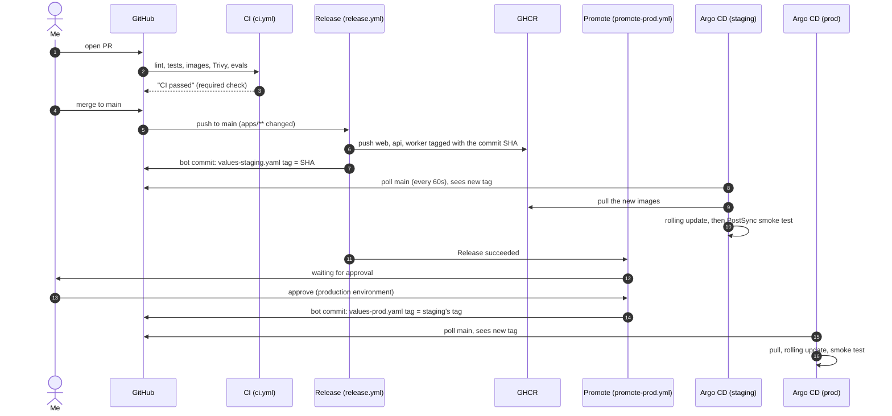

# How a deploy works

One sentence: **I merge a PR, staging updates itself a few minutes later, and prod updates after I click Approve.** Nobody runs `kubectl` or `helm` by hand, and CI never has the keys to a cluster.

This page follows one change all the way through. File names are real, so you can open each one next to it.



What stops a bad change, in order:

| Gate | Where | Catches |
|---|---|---|
| Lint, unit tests (LLM mocked) | `ci.yml`, every PR | Broken code, style |
| Helm lint, terraform validate | `ci.yml`, every PR | A chart or infra change that won't render |
| Trivy | `ci.yml`, every PR | Critical CVEs with a fix available, in all three images |
| AI evals | `ci.yml`, only PRs touching the worker or evals | A prompt or model change that makes the cards worse |
| Docs check | `ci.yml`, every PR | A README that points at files that no longer exist |
| Smoke test | Argo CD PostSync hook, every deploy | A deploy that comes up but can't turn a PDF into cards |
| Human approval | `production` GitHub Environment | Anything staging didn't show |

## The timeline

Real numbers from deploying [PR #14](https://github.com/copaaglo/flashcards/pull/14) on 2026-11-02, when staging and prod were both up ([Release run](https://github.com/copaaglo/flashcards/actions/runs/41510101065), [Promote to prod run](https://github.com/copaaglo/flashcards/actions/runs/41510282453)):

| # | Step | Who does it | Takes |
|---|---|---|---|
| 1 | CI on the PR | GitHub Actions, `.github/workflows/ci.yml` | about 1.5 minutes (77s) |
| 2 | Merge | Me, once **CI passed** is green | seconds |
| 3 | Build and push images | `release.yml`, job `images` | about 1 minute (53s for the slowest image, with build cache) |
| 4 | Point staging at the new images | `release.yml`, job `promote-staging` | 8 seconds |
| 5 | Notice and sync | Argo CD in the staging cluster | up to 60s to notice, then the rollout |
| 6 | Smoke test | Argo CD PostSync hook | about a minute (one real LLM call) |
| 7 | Wait for approval | `promote-prod.yml`, `production` environment | as long as I take |
| 8 | Point prod at the same images | `promote-prod.yml` | 7 seconds |
| 9 | Notice, sync, smoke test | Argo CD in the prod cluster | same as 5 and 6 |

Merge to the staging bot commit took 66 seconds (merged 19:27:23, bot commit 19:28:29 UTC). Add up to 60 seconds for Argo CD to notice, then the rollout and smoke test: about 3 to 4 minutes from merge to verified on staging. The Argo CD part is an estimate; the rest is measured.

## 1. Pull request: prove it's safe to merge

Every PR runs `.github/workflows/ci.yml`. The jobs run in parallel:

- **Lint:** ruff for Python, eslint for the web app, `helm lint --strict` with every values file, `terraform fmt` and `terraform validate` for every root.
- **Test:** pytest for the api and worker. The LLM is mocked, so tests are free and deterministic.
- **Build and scan:** all three Docker images get built (not pushed) and Trivy fails the job on any critical CVE that has a fix.
- **AI evals:** only when the PR touches `apps/worker/`, `evals/` or `ci.yml`. Eight sample lectures go through the real prompt and model, and the cards get scored. Below the threshold, the job fails. See [ADR 0005](decisions/0005-ai-evals-as-a-merge-gate.md).
- **Docs:** `scripts/check-docs.py` makes sure the README and these docs only point at files that exist.

One job, **CI passed**, waits for all of them, and it's the only required check on `main`. A skipped job (evals on a PR that didn't touch the worker) counts as fine; a failed or cancelled one doesn't. That way the branch rule never has to change when a job is added or renamed.

SonarCloud runs too, but it isn't part of **CI passed**, so an outage on their side can't block a merge.

## 2. Merge: build the images once

A merge to `main` that changes anything under `apps/` starts `.github/workflows/release.yml`.

The `images` job builds web, api and worker for both `linux/amd64` and `linux/arm64` (same image on my Apple Silicon laptop and on the ARM cloud VMs) and pushes them to GHCR:

```
ghcr.io/copaaglo/flashcards-api:<full commit SHA>
```

The commit SHA is the only tag. There is no `latest`, so "what's running in prod?" always has an exact answer: a commit you can open on GitHub. See [ADR 0003](decisions/0003-build-once-promote-the-same-image.md).

## 3. Promote to staging: a commit, not a command

The `promote-staging` job doesn't talk to the cluster. It edits one line in `deploy/helm/flashcards/values-staging.yaml`:

```yaml
image:
  tag: <the new SHA>
```

and pushes that as a commit from `flashcards-deploy-bot`. `main` is protected, so the push uses a deploy key that is on the ruleset's bypass list. That key is stored in the `staging` GitHub Environment, which only the `main` branch can use, so a workflow on a random branch can't read it.

Two details that keep this from looping:

- The commit message ends in `[skip ci]`, so it doesn't start another CI run.
- The commit only changes `deploy/`, and `release.yml` only runs on `apps/**`, so it doesn't start another release.

## 4. Argo CD: the cluster pulls the change

Argo CD runs inside the staging cluster and checks `main` every 60 seconds (`deploy/argocd/argocd-values.yaml`). The Application in `deploy/argocd/flashcards-staging.yaml` says "render `deploy/helm/flashcards` with `values-staging.yaml`, and make namespace `flashcards-staging` match". It sees the new tag and syncs:

1. **Sync wave -1:** the SecretStore and ExternalSecret. Argo CD waits until External Secrets has built `flashcards-secrets` from AWS Secrets Manager. This is the fix for the boot race from Phase 5, where the api started before its database URL existed.
2. **Wave 0:** the Deployments, Services and Ingress. Kubernetes does a rolling update: a new pod has to pass its readiness probe before it gets traffic and an old one goes away.
3. **PostSync:** the smoke test Job (`templates/smoke-test.yaml`) uploads `files/smoke.pdf` through the real ingress path, waits for the job, and checks that cards came back. If it fails, the sync is marked failed and Argo CD shows it red.

The workers get 630 seconds to stop (`terminationGracePeriodSeconds`), longer than the 600 second job timeout, so a rollout never kills a job halfway.

Why pull instead of CI running `helm upgrade`? Because then CI would need cluster admin credentials, and anyone who can change a workflow could use them. Here the cluster only needs to read a public Git repo. Git is also the full deploy history: `git log deploy/helm/flashcards/values-prod.yaml` is the list of every prod deploy. See [ADR 0002](decisions/0002-gitops-ci-never-deploys.md).

## 5. Promote to prod: a person says yes

When Release finishes, `.github/workflows/promote-prod.yml` starts and immediately pauses, because the `production` environment has a required reviewer. GitHub shows **Review deployments** on the run. I look at staging, then approve.

The job then reads the tag from `values-staging.yaml` **at the moment of approval**, checks that it's a 40 character commit SHA, copies it into `values-prod.yaml`, and pushes a bot commit with the prod deploy key (a different key from staging's). Argo CD in the prod cluster takes it from there, same as step 4, smoke test included.

Prod can only ever run an image that ran on staging first, because the tag comes from staging's file. If two releases land before I approve, prod skips straight to the newer one.

## When it goes wrong

| What broke | What you see | What to do |
|---|---|---|
| CI fails | Red **CI passed** on the PR, merge button blocked | Fix it on the branch. Nothing deployed. |
| Release fails | Red run in Actions, staging unchanged | Re-run it from the Actions tab (`workflow_dispatch`). Prod promotion doesn't start for a failed release. |
| Smoke test fails on staging | Argo CD app Degraded or sync failed | Don't approve prod. Check the `smoke-test` Job logs, then roll back. |
| Something's wrong in prod | Alerts, or users | Roll back (below). |

### Rolling back

A deploy is a commit, so a rollback is a revert of that commit:

```bash
git log --oneline -5 -- deploy/helm/flashcards/values-prod.yaml
```

Find the `Deploy abc1234 to prod` commit, then on a new branch:

```bash
git revert <that commit's SHA>
```

Open a PR, merge it, and Argo CD puts the previous tag back within a minute. The old images are still in GHCR, so nothing gets rebuilt. Use the same steps with `values-staging.yaml` for staging.

Why not the Rollback button in Argo CD? It's disabled while automated sync is on, and on purpose: Git is the source of truth, and a rollback done only in the cluster would be undone by the next sync.

The revert goes through a PR and **CI passed** like any change. That's a few minutes in an emergency. Some teams let a revert of a bot commit skip review; this repo doesn't, to keep one rule for everything.

## Known gaps in this process

- **Chart changes skip staging.** Both Applications follow `main`, and the templates are shared. A change to `deploy/helm/flashcards/templates/` reaches staging and prod at the same time, with no approval. Only image tags go through promotion. The fix is to pin prod to something that moves only on promotion: a Git tag, a released chart version, or rendered manifests per environment.
- **No automatic rollback.** A failed smoke test marks the sync failed but leaves the new pods running. Argo Rollouts (canary with automatic analysis) is the next step up.
- **Argo CD polls.** Up to 60 seconds of nothing happening. A GitHub webhook to Argo CD would make it instant, but needs the Argo CD API reachable from the internet.
